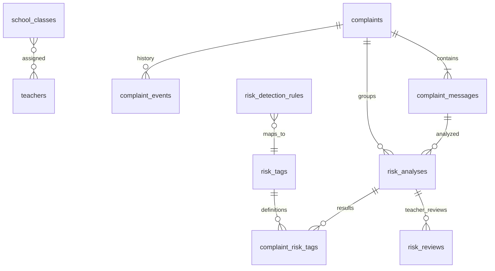

# 민원 및 위험 분석 저장 구조

- `complaints`: parent_id, student_id, teacher_id, title, status, waiting_for, closed_at,
  created_at, updated_at. 하나의 민원 대화방을 나타낸다. 최초 생성 시 학생의 담당 교사 중 한 명을 문의 대상으로 선택하고 제목을 저장한다. 상태는 DRAFT, OPEN, CLOSED이고
  `waiting_for`는 다음 작성 차례(PARENT, TEACHER, NONE)를 나타낸다.
- `school_class_teachers`: school_class_id, teacher_id. 학급별 복수 담당 교사를 관리한다. 기존 담임교사는 선택 가능 교사에 기본 포함한다.
- `complaint_messages`: complaint_id, sender_id, type, status,
  content, masked_content, content_version, sent_at, read_at, created_at, updated_at.
  학부모 문의와 교사 답변을 같은 메시지 모델에 저장한다. 임시저장은 DRAFT, 전송은 SENT,
  상대가 답변하거나 종료를 선택하면 READ다.
- `risk_tags`: code, name, default_score. 기존 기준 정보 조회 기능을 유지한다.
- `risk_detection_rules`: rule_id, source_tag_code, tag_code, expression, match_type,
  context_required, context_subtype, normalization_rule, dataset_version, enabled.
  CSV v1.1의 72개 후보 신호를 저장하며 애플리케이션에서 캐시해 사용한다.
- `risk_analyses`: complaint_id, message_id, risk_score, risk_level, model_name, temperature,
  analysis_mode, revision_status, credible_threat, student_safety_concern, privacy_exposure, analyzed_at.
  message_id와 content_version으로 분석 대상 메시지 버전을 구분한다.
  `analysis_mode`은 정상 Rule+LLM 분석인 `HYBRID`와 외부 AI 실패 후 잠정 분석인 `RULE_ONLY`를
  구분한다. 현재는 H2 create-drop이 엔티티 정의에 따라 컬럼을 생성한다.
- `risk_reviews`: risk_analysis_id, reviewed_by, previous_score, previous_level,
  reviewed_score, reviewed_level, direction, reason, reviewed_at. 시스템 분석은 변경하지
  않고 교사의 위험도 검토를 시간순으로 누적한다.
- `complaint_risk_tags`: risk_analysis_id, risk_tag_id, rule_detected, llm_detected,
  final_detected, confidence, severity, repeat_count, evidence. 분석 1건에 전체 8개 태그를 저장한다.
  분석 ID와 태그 ID 조합은 유일하다.
- `complaint_events`: complaint_id, actor_id, actor_name, event_type, reference_type,
  reference_id, previous_status, new_status, risk_score, risk_level, previous_risk_score,
  previous_risk_level, reason, occurred_at. 상태 변경·위험 분석·교사 검토·원문 열람·AI 초안
  생성 요청·메시지 전송 이력을 한 테이블에 append-only 방식으로 저장한다.

## 현재 파이프라인

RiskAnalysisService: 본인/DRAFT 검증 → 학생·교사 관계자 마스킹 컨텍스트 생성 → 원문 마스킹
→ CSV Rule 후보 탐지 → 같은 컨텍스트로 Rule 근거 마스킹
→ 마스킹 본문과 Rule 후보를 LLM에 전달 → AI 출력 근거 재마스킹 → Claude 우선 태그 병합 → 점수 계산 및 결과 저장
→ 검토 응답 → 비동기 수정안 생성. 외부 LLM 호출 전후에는 짧은 트랜잭션만 사용하고,
AI 대기 중에는 민원 잠금을 유지하지 않는다. 일반 Rule 후보는 BOUNDARY, HINT_ONLY는 UNKNOWN으로 전달하며 키워드만으로
PRESENT를 확정하지 않는다. 결정론적 Rule PRESENT와 LLM PRESENT는 합집합으로 보존하고,
태그별 점수는 두 출처 중 최댓값만 사용한다. 누락한 태그는 Rule 상태로 fallback한다.
수정안 출력도 분석 요청과 같은 관계자 컨텍스트로 다시 마스킹하며, 수정본은 자동 적용하지 않는다.
LLM 스키마 오류는 한 번 재생성하고, 재생성 실패 또는 외부 AI 장애 시 전체 Rule 결과만으로
점수·등급을 계산해 `RULE_ONLY`로 저장한다. 이 경우 AI 수정안은 생성하지 않는다.
위험 분석 성공 후 수정안 생성만 실패하면 HYBRID 판정은 유지하고 revision_status를
`UNAVAILABLE`로 저장한다.

시스템 분석은 Rule 점수와 `default_score × severity`인 LLM 점수 중 태그별 최댓값을 합산한다.
같은 태그가 두 탐지기에서 발견되어도 중복 계산하지 않고 최대 100점으로 제한한다.
confidence는 점수에 사용하지 않는다. 시스템 점수는 0~20점 LOW, 21~40점 MEDIUM,
41~60점 HIGH, 61~100점 EMERGENCY다. 세 안전 신호 중 하나라도 true이면 100점
EMERGENCY로 승격한다.

교사는 1~7 선택 척도를 사용하고 서버는 선택값에 10을 곱해 시스템과 같은 단위의
10~70점으로 환산한다. 최초 검토 위치는 시스템 등급을
LOW 2점, MEDIUM 4점, HIGH 6점, EMERGENCY 7점으로 변환해 정한다. 교사용 점수의
1~2점은 LOW, 3~4점은 MEDIUM, 5~6점은 HIGH, 7점은 EMERGENCY다. 상향·하향 조정은
사유가 필수이고 동일 점수 확인은 사유가 선택 사항이다. 각 검토는 별도
행으로 저장하며 조회·처리 정책에는 가장 최근 검토 등급을 사용한다.

학부모 메시지는 전송 전에 동일 메시지를 대상으로 위험 분석과 수정 제안을 받는다. 내용 수정 시
masked_content를 비우고 content_version을 증가시킨다. 최초 메시지를 보내면 민원은 OPEN이며
교사 차례가 된다. 교사는 LOW·MEDIUM에서 답변 초안을 검토·수정해 보낼 수 있고,
HIGH에서는 검증된 제한형 공식 템플릿을 채택한 내용만 저장·전송할 수 있다.
EMERGENCY에서는 개별 답변 생성을 차단한다.
교사 답변 뒤에는 학부모 차례가 된다. 학부모는 같은 흐름으로 추가 문의를 보내거나 답변을
확인하고 민원을 CLOSED로 종료한다. AI 초안 생성 결과는 응답으로만 반환하고 DB에 저장하지
않는다. 교사가 수정한 내용은 일반 답변 초안 또는 최종 메시지에 저장한다. AI 초안 생성 사실은
`AI_DRAFT_GENERATED` 이벤트로만 남긴다. High 템플릿 조회·채택과 정책 차단도 감사 이벤트로 남긴다.

교사용 대화 조회에서는 모든 학부모 메시지를 각각의 최신 완료 위험 분석과 연결한다.
모든 위험도의 학부모 메시지는 최초/추가 문의 구분 없이 완충 요약을 표시한다. 완충 요약
제공자에는 마스킹된 입력만 전달하고 생성 결과도 다시 마스킹한다. 완충 요약 생성에 실패하면
원문을 자동 노출하지 않고 `summaryStatus=UNAVAILABLE` 안내를 반환한다. 원문은 별도 열람 API와
감사 이벤트를 통해 확인한다. 교사 메시지는 원문을 그대로 표시하며 DRAFT 메시지는 대화에서 제외한다.

히스토리 API는 더 이상 여러 도메인 테이블을 합쳐 정렬하지 않고 `complaint_events`를
발생 시각 역순으로 한 번 조회한다. 읽음 이벤트를 포함하며 현재 도메인 상태와 대조해
누락 로그를 별도로 표시한다. `complaint_status_history`와
`complaint_original_view_logs`는 `complaint_events`로 통합해 제거했다.

## risk DTO: 5개

RiskTagDetectionResult(탐지기별 태그), LlmRiskAnalysisResult(태그/모델 정보/설명/수정본),
FinalRiskTagResponse(병합 태그), RiskAnalysisSummaryResponse(룰 엔진 위험도와 병합 결과),
RiskTagResponse(태그 기준 정보). 규칙 탐지기는 List<RiskTagDetectionResult>를 직접 반환한다.

## 스키마 적용

현재 개발 환경은 H2 메모리 DB와 ddl-auto=create-drop으로 엔티티에 따라 생성하며 영구 DB는
아직 사용하지 않는다. 영구 DB 도입 시 현재 엔티티 전체를 기준으로 초기 마이그레이션을 만들고,
운영 데이터가 생긴 이후의 증분 변경부터 백필·롤백 정책을 함께 관리한다.
기존 ai_drafts는 필요하면 `AI_DRAFT_GENERATED` 이벤트로 변환한 후 테이블과
complaint_messages.ai_draft_id 외래 키를 제거한다. created_at은 민원 DRAFT 생성 시간이다.
