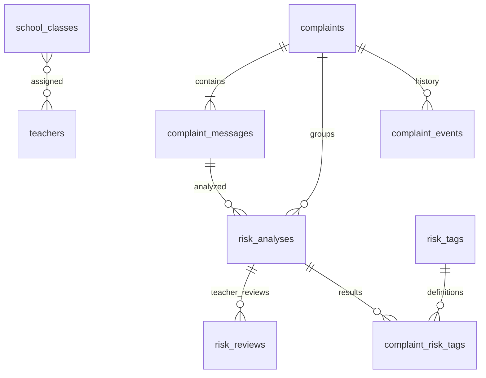

# 민원 및 위험 분석 저장 구조

- `complaints`: parent_id, student_id, teacher_id, title, status, waiting_for, closed_at,
  created_at, updated_at. 하나의 민원 대화방을 나타낸다. 최초 생성 시 학생의 담당 교사 중 한 명을 문의 대상으로 선택하고 제목을 저장한다. 상태는 DRAFT, OPEN, CLOSED이고
  `waiting_for`는 다음 작성 차례(PARENT, TEACHER, NONE)를 나타낸다.
- `school_class_teachers`: school_class_id, teacher_id. 학급별 복수 담당 교사를 관리한다. 기존 담임교사는 선택 가능 교사에 기본 포함한다.
- `complaint_messages`: complaint_id, sender_id, type, status,
  content, masked_content, content_version, sent_at, read_at, created_at, updated_at.
  학부모 문의와 교사 답변을 같은 메시지 모델에 저장한다. 임시저장은 DRAFT, 전송은 SENT,
  상대가 답변하거나 종료를 선택하면 READ다.
- `risk_tags`: code, name, default_score. 기존 기준 정보 조회 기능을 유지한다.
- `risk_analyses`: complaint_id, message_id, risk_score, risk_level, model_name, temperature,
  analyzed_at. message_id와 content_version으로 분석 대상 메시지 버전을 구분한다.
- `risk_reviews`: risk_analysis_id, reviewed_by, previous_score, previous_level,
  reviewed_score, reviewed_level, direction, reason, reviewed_at. 시스템 분석은 변경하지
  않고 교사의 위험도 검토를 시간순으로 누적한다.
- `complaint_risk_tags`: risk_analysis_id, risk_tag_id, rule_detected, llm_detected,
  final_detected, confidence, evidence. 분석 1건에 전체 8개 태그를 저장한다.
  분석 ID와 태그 ID 조합은 유일하다.
- `complaint_events`: complaint_id, actor_id, actor_name, event_type, reference_type,
  reference_id, previous_status, new_status, risk_score, risk_level, previous_risk_score,
  previous_risk_level, reason, occurred_at. 상태 변경·위험 분석·교사 검토·원문 열람·AI 초안
  생성 요청·메시지 전송 이력을 한 테이블에 append-only 방식으로 저장한다.

## 현재 파이프라인

ComplaintReviewService: 본인/DRAFT 검증 → 원문 규칙 탐지 → 마스킹 → LLM 분석
→ 태그 OR 병합 → RiskAnalysisService의 점수 계산 및 결과 저장 → 검토 응답.
실패 시 마스킹 변경과 분석 저장을 동일 트랜잭션으로 롤백한다.
규칙 탐지와 LLM은 mock이며 수정본은 자동 적용하지 않는다.

시스템 분석은 기존 정책을 유지한다. 최종 탐지된 태그의 default_score를 합산하고,
같은 태그가 두 탐지기에서 발견되어도 한 번만 계산한다. 시스템 점수는 0~1점 LOW,
2~4점 MEDIUM, 5점 이상 HIGH이며 현재 자동 계산에서는 EMERGENCY를 반환하지 않는다.

교사 검토에만 별도의 1~7점 척도를 적용한다. 최초 검토 위치는 시스템 등급을
LOW 2점, MEDIUM 4점, HIGH 6점, EMERGENCY 7점으로 변환해 정한다. 교사용 점수의
1~2점은 LOW, 3~4점은 MEDIUM, 5~6점은 HIGH, 7점은 EMERGENCY다. 하향 조정은
사유가 필수이고, 상향 또는 동일 점수 확인은 사유가 선택 사항이다. 각 검토는 별도
행으로 저장하며 조회·처리 정책에는 가장 최근 검토 등급을 사용한다.

학부모 메시지는 전송 전에 동일 메시지를 대상으로 위험 분석과 수정 제안을 받는다. 내용 수정 시
masked_content를 비우고 content_version을 증가시킨다. 최초 메시지를 보내면 민원은 OPEN이며
교사 차례가 된다. 교사는 mock 기반 AI 답변 초안을 수정하거나 직접 작성해 보낼 수 있고,
교사 답변 뒤에는 학부모 차례가 된다. 학부모는 같은 흐름으로 추가 문의를 보내거나 답변을
확인하고 민원을 CLOSED로 종료한다. AI 초안 생성 결과는 응답으로만 반환하고 DB에 저장하지
않는다. 교사가 수정한 내용은 일반 답변 초안 또는 최종 메시지에 저장한다. AI 초안 생성 사실은
`AI_DRAFT_GENERATED` 이벤트로만 남긴다. 공식 템플릿 조회는 아직 포함하지 않는다.

교사용 대화 조회에서는 모든 학부모 메시지를 각각의 최신 완료 위험 분석과 연결한다.
LOW 메시지는 원문을 표시하고 MEDIUM, HIGH, EMERGENCY 메시지는 최초/추가 문의 구분 없이
완충 요약을 표시한다. 교사 메시지는 원문을 그대로 표시하며 DRAFT 메시지는 대화에서 제외한다.

히스토리 API는 더 이상 여러 도메인 테이블을 합쳐 정렬하지 않고 `complaint_events`를
발생 시각 역순으로 한 번 조회한다. `complaint_status_history`와
`complaint_original_view_logs`는 `complaint_events`로 통합해 제거했다.

## risk DTO: 5개

RiskTagDetectionResult(탐지기별 태그), LlmRiskAnalysisResult(태그/모델 정보/설명/수정본),
FinalRiskTagResponse(병합 태그), RiskAnalysisSummaryResponse(룰 엔진 위험도와 병합 결과),
RiskTagResponse(태그 기준 정보). 규칙 탐지기는 List<RiskTagDetectionResult>를 직접 반환한다.

## 스키마 적용

현재 개발 환경은 H2 메모리 DB와 ddl-auto=create-drop으로 엔티티에 따라 생성한다.
영구 DB에는 자동 적용하지 않았다. 기존 complaint 테이블이 있는 환경은 배포 전에
complaints 상태/차례 컬럼, complaint_messages 테이블, risk_analyses.message_id 생성을 위한
별도 마이그레이션이 필요하다. complaint_events 테이블을 생성하고 기존
complaint_status_history, complaint_original_view_logs뿐 아니라 완료된 risk_analyses,
risk_reviews, 전송된 complaint_messages도 이벤트 행으로 백필해야 기존 히스토리가
유지된다. 기존 complaints 본문과 responses 데이터는 메시지 행으로 이관해야 한다.
기존 ai_drafts는 필요하면 `AI_DRAFT_GENERATED` 이벤트로 변환한 후 테이블과
complaint_messages.ai_draft_id 외래 키를 제거한다. created_at은 민원 DRAFT 생성 시간이다.
